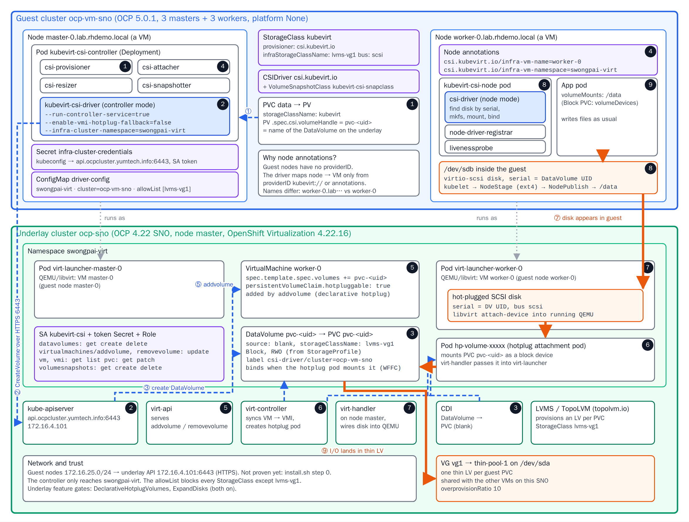

# Deploy the KubeVirt CSI driver on OpenShift-on-OpenShift

This repo connects a guest OpenShift cluster, whose nodes are OpenShift Virtualization VMs, to a StorageClass on the underlay cluster that runs those VMs. You create a PVC on the guest. The driver creates a DataVolume on the underlay and hot-plugs it into the guest node VM that runs the pod.



For the full diagram with clickable steps, open [`kubevirt-csi-diagram.html`](kubevirt-csi-diagram.html) in a browser. For the design decisions and the measured state of both clusters, read [`PLAN.md`](PLAN.md).

> [!WARNING]
> Red Hat supports the KubeVirt CSI driver only inside Hosted Control Planes on KubeVirt. On a standalone cluster, such as one installed by the Assisted Installer, this setup uses the upstream community driver and has no Red Hat support.

## Prerequisites

- An underlay OpenShift cluster with OpenShift Virtualization. The guest node VMs must run in one namespace.
- A guest OpenShift cluster whose nodes are those VMs.
- `oc` and `jq` on your workstation, with one kubeconfig context for each cluster.
- Cluster-admin on both clusters.
- Network access from the guest nodes to the underlay API on port 6443.

The defaults in this repo match this lab:

| Setting | Value |
| --- | --- |
| Underlay context | `ocp-sno` |
| Guest context | `ocp-vm-sno` |
| Namespace of the guest node VMs | `swongpai-virt` |
| Underlay StorageClass | `lvms-vg1` (LVMS, Block RWO) |
| Underlay VolumeSnapshotClass | `lvms-vg1` |
| Underlay hotplug feature gate | `DeclarativeHotplugVolumes` |

## Repo layout

| Path | Applied to | Contents |
| --- | --- | --- |
| `infra/rbac.yaml` | underlay | ServiceAccount `kubevirt-csi`, its token Secret, and a Role in the VM namespace |
| `tenant/common/` | guest | Namespace, CSIDriver, node DaemonSet, RBAC, `driver-config`, StorageClass `kubevirt`, VolumeSnapshotClass |
| `tenant/controller/` | guest | Controller Deployment |
| `bin/install.sh` | both | Runs every install step. Safe to rerun. |
| `bin/verify.sh` | both | Tests a real volume end to end, then cleans up |

The kustomizations pull the upstream [kubevirt/csi-driver](https://github.com/kubevirt/csi-driver) manifests at commit `b7b6b9aa`. The driver image is pinned by digest, because upstream publishes no releases.

## Adapt the repo to your clusters

Skip this section if your clusters match the defaults.

1. Set the context names and the VM namespace as environment variables:

	```bash
	export INFRA=<underlay-context> GUEST=<guest-context> INFRA_NS=<vm-namespace>
	```

2. In `infra/rbac.yaml`, replace every `swongpai-virt` with your VM namespace.
3. In `tenant/common/driver-config.yaml`, set these keys:
	- `infraClusterNamespace` to your VM namespace.
	- `infraClusterLabels` to a label that is unique to this guest cluster.
	- `allowList` and `storageSnapshotMapping` to your underlay StorageClass and VolumeSnapshotClass.
4. In `tenant/common/storage-classes.yaml`, set `infraStorageClassName` and `infraSnapshotClassName` to the same underlay classes.
5. If your underlay uses the `HotplugVolumes` feature gate instead of `DeclarativeHotplugVolumes`, remove the `--enable-vmi-hotplug-fallback=false` patch from `tenant/controller/kustomization.yaml`.

Keep the keys in `infraStorageClassEnforcement` lowercase. The driver ignores `StorageClasses` with a capital S, even though the upstream docs show that spelling.

## Install

1. Clone the repo and change into it:

	```bash
	git clone https://github.com/Surote/kubevirt-csi-ocp-deployment.git
	cd kubevirt-csi-ocp-deployment
	```

2. Run the installer:

	```bash
	bin/install.sh
	```

The installer runs these steps in order. It stops at the first step that fails.

| Step | Cluster | Action | Check |
| --- | --- | --- | --- |
| 0 | guest | Runs `curl` from a worker node to the underlay API with `oc debug` | HTTP 200 |
| 1 | underlay | Applies `infra/rbac.yaml` | The token Secret gets a token |
| 2 | guest | Annotates every node with `csi.kubevirt.io/infra-vm-name` and `csi.kubevirt.io/infra-vm-namespace` | Every node matches a VMI by SMBIOS UUID |
| 3 | guest | Creates Secret `infra-cluster-credentials` with a kubeconfig for the underlay | Secret exists |
| 4 | guest | Applies `tenant/common`, then `tenant/controller`, and restarts the pods | Rollouts finish |
| 5 | guest | Counts the nodes that registered `csi.kubevirt.io` | Equal to the node count |

The node annotations are required. The driver finds a node's VM from `providerID: kubevirt://<vm>` or from those two annotations. Nodes installed by the Assisted Installer have no such `providerID`.

If step 0 fails, open TCP 6443 from the guest node network to the underlay API, then rerun `bin/install.sh`.

## Verify

Run the end-to-end test:

```bash
bin/verify.sh
```

The script creates a namespace `kubevirt-csi-verify` on the guest and prints one `PASS` line for each check:

- A filesystem PVC and a Block PVC bind, and a pod that uses both starts.
- Each PV maps to a DataVolume on `lvms-vg1` in the VM namespace.
- Each DataVolume is in the backing VM's `spec.template.spec.volumes`.
- A file written to the filesystem PVC reads back.
- The filesystem PVC expands from 1Gi to 2Gi.
- A VolumeSnapshot becomes `readyToUse`.
- After the namespace is deleted, the DataVolumes are gone from the underlay.

The script deletes its namespace when it exits, including on failure.

## Use the StorageClass

Set `storageClassName: kubevirt` on a PVC:

```yaml
apiVersion: v1
kind: PersistentVolumeClaim
metadata:
  name: data
spec:
  storageClassName: kubevirt
  accessModes: [ReadWriteOnce]
  resources:
    requests:
      storage: 10Gi
```

The guest default StorageClass stays `nfs-csi`. To make `kubevirt` the default, run these commands:

```bash
oc --context ocp-vm-sno annotate sc nfs-csi storageclass.kubernetes.io/is-default-class=false --overwrite
oc --context ocp-vm-sno annotate sc kubevirt storageclass.kubernetes.io/is-default-class=true --overwrite
```

## Limits

- `kubevirt` supports `ReadWriteOnce` only, because `lvms-vg1` is local to one node. Use `nfs-csi` for `ReadWriteMany`.
- Guest PVCs share the underlay thin pool with every other VM on that cluster. Watch the thin pool usage on the underlay.
- When a guest node VM stops, its hot-plugged disks detach. Pods on that node lose their volumes until the VM starts again.

## Rotate the underlay token

The token in `infra-cluster-credentials` does not expire. To rotate it, delete the token Secret on the underlay and rerun the installer:

```bash
oc --context ocp-sno delete secret kubevirt-csi-token -n swongpai-virt
bin/install.sh
```

## Uninstall

> [!CAUTION]
> Delete every PVC that uses `kubevirt` first. Otherwise the DataVolumes stay on the underlay with no owner.

1. Confirm that no PVC uses `kubevirt`. The command must print nothing:

	```bash
	oc --context ocp-vm-sno get pvc -A -o json | jq -r '.items[] | select(.spec.storageClassName=="kubevirt") | "\(.metadata.namespace)/\(.metadata.name)"'
	```

2. Remove the driver from the guest:

	```bash
	oc --context ocp-vm-sno delete -k tenant/controller
	oc --context ocp-vm-sno delete -k tenant/common
	oc --context ocp-vm-sno annotate nodes --all csi.kubevirt.io/infra-vm-name- csi.kubevirt.io/infra-vm-namespace-
	```

3. Remove the identity from the underlay:

	```bash
	oc --context ocp-sno delete -f infra/rbac.yaml
	```

4. Confirm that no DataVolume is left on the underlay. The command must print nothing:

	```bash
	oc --context ocp-sno get dv -n swongpai-virt -l csi-driver/cluster=ocp-vm-sno
	```

## Regenerate the PNG

The PNG is a screenshot of `kubevirt-csi-diagram.html`. To regenerate it after you edit the HTML, take a screenshot of the `#main` SVG at a device scale factor of 2 with any headless Chromium. One way is the `mcr.microsoft.com/playwright/python` container.
